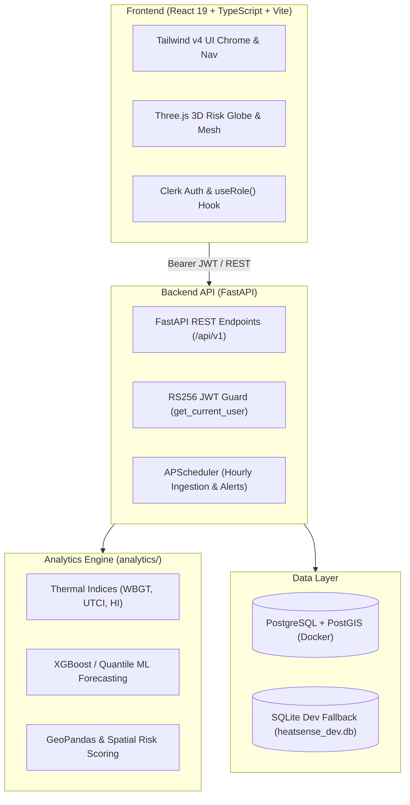

# ThermaGrid

**ThermaGrid** is a hyperlocal human thermal-stress early-warning and municipal decision-support system. While conventional weather apps report city-level ambient temperatures, ThermaGrid computes true physiological heat strain (ISO 7243 WBGT, UTCI, Heat Index) combined with ward-level built-environment vulnerability—identifying who is at risk, where thermal loading concentrates, when diurnal peaks occur, and what automated interventions save lives.

---

## Screenshots

| Public Landing | Overview Hub | Municipal Authority Console |
| :---: | :---: | :---: |
|  |  |  |

---

## Quick Start (Linux Mint)

```bash
git clone https://github.com/AkshatKardak/ThermaGrid.git && cd ThermaGrid
docker compose up -d db
cd backend && python3 -m venv .venv && source .venv/bin/activate
pip install -r requirements.txt && fastapi dev app/main.py
# new terminal
cd frontend && npm install && npm run dev
```

---

## Environment Variables

Configure `.env` files in root, `backend/`, and `frontend/` using templates:

| Variable | Scope | Purpose | Reference |
|---|---|---|---|
| `DATABASE_URL` | Backend | PostgreSQL + PostGIS connection string *(SQLite dev fallback)* | `backend/.env.example` |
| `CLERK_SECRET_KEY` | Backend | Server-side Clerk JWT signature verification | `backend/.env.example` |
| `RESEND_API_KEY` | Backend | Transactional email dispatch for heat alerts | `backend/.env.example` |
| `WHATSAPP_TOKEN` | Backend | Meta WhatsApp Cloud API alert broadcasts | `backend/.env.example` |
| `VITE_API_BASE_URL` | Frontend | FastApi API V1 root endpoint | `frontend/.env.example` |
| `VITE_CLERK_PUBLISHABLE_KEY` | Frontend | Client-side Clerk authentication publishable key | `frontend/.env.example` |
| `VITE_MAP_STYLE_URL` | Frontend | CartoDB Dark Matter / MapLibre vector style URL | `frontend/.env.example` |

---

## Demo Accounts

Pre-configured verified Clerk users for immediate zero-friction evaluation:

| Email | Password | Clerk Role (`publicMetadata.role`) | Unlocked Access |
|---|---|---|---|
| `authority@thermagrid.demo` | `ThermaGrid#2026` | `authority` | Municipal Command Deck, Intervention Queue, Broadcasts |
| `citizen@thermagrid.demo` | `ThermaGrid#2026` | `citizen` | Citizen Heat Risk, Safe Windows, Subscriptions |

> *Note: Roles are cryptographically embedded into Clerk signed session tokens via Clerk Dashboard metadata.*

---

## Architecture



---

## Features

1. **[P0] Safe-Window Planner:** Slides duration window across 24h forecast to find safe hours below activity threshold (`GET /planner/safe-windows`).
2. **[P0] Night-Time Risk (Tropical Nights):** Overnight biometeorological curve and guidance flag for tropical nights ($\ge 25.0^\circ\text{C}$).
3. **[P0] Indoor Heat by Building Type:** Evaluates indoor thermal elevation and 2–3 hour thermal lag across roof archetypes (`tin_roof`, `rcc`).
4. **[P0] Self-Serve Alert Subscriptions:** User-scoped WhatsApp/Email subscriptions with live threshold slider and quiet hours suppression.
5. **[P1] Care Circle (People You Watch):** Multi-ward family monitoring strips displaying live thermal strain on dependents.
6. **[P1] Worker Shift Card:** ISO 7243 compliant rest intervals, hydration targets, and print-optimized A5 schedule generator.
7. **[P1] Usable Cooling Centres:** Real-time distance sorting, walk time calculation, factual Open/Closed status, and Google Maps directions.
8. **[P2] Local Language (i18n):** Complete localized UI in `en`, `hi`, `mr`, `ta`, and `bn` with Latin unit preservation.

---

## Methodology & Limitations

- **Normative Thermal Indices:** Liljegren (2008) Wet-Bulb Globe Temperature (WBGT), Bröde et al. (2012) Universal Thermal Climate Index (UTCI), and Rothfusz (1990) National Weather Service Heat Index.
- **Composite Risk Model:** Normalized composite index $R = w_h H + w_e E + w_v V - w_a A$ parameterized via `analytics/config/weights.yaml`.
- **Statutory Public Health Advisory:** Outputs constitute environmental decision-support estimates, not individualized clinical diagnoses. For acute heat stroke emergencies, contact emergency medical services (108).

---

## Datasets & Licences

| Dataset / Source | Resolution | Update Cadence | Licence | Type |
|---|---|---|---|---|
| Open-Meteo NWP & Reanalysis | 1.1 km – 11 km | Hourly | CC BY 4.0 | Real / Observed |
| IMD Automatic Weather Stations | Surface AWS Points | 15-Minute | GODL India | Ground Truth |
| Census of India Ward Boundaries | Polygon (Ward-Level) | Decennial | Open Government | Demographic |
| Synthetic Calibration Telemetry | Ward Simulation | Dynamic | MIT License | `is_synthetic = True` |

---

## Testing

```bash
# Run backend & analytics pytest suite (23 tests)
cd backend && .venv/bin/pytest -v

# Run frontend production build & type check
cd frontend && npm run build
```

---

## License

ThermaGrid is open-source software licensed under the [MIT License](LICENSE).
