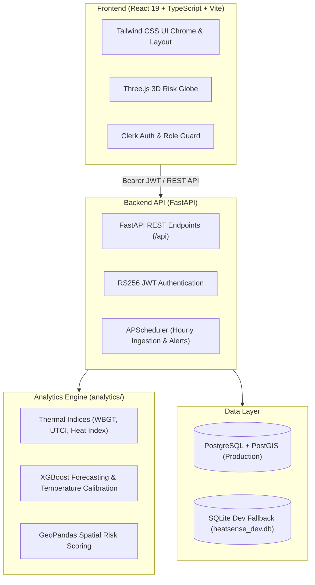

# ThermaGrid

Hyperlocal human thermal-stress early-warning and municipal decision-support system.

---

## Problem Statement

Urban heatwaves are among the deadliest climate hazards, yet municipal disaster response systems and consumer weather applications suffer from critical blind spots:

1. **Ambient Temperature vs. Physiological Strain:** Standard weather reports show macro-level dry-bulb ambient temperature collected from distant airport weather stations. They ignore the combined physical impact of humidity, solar radiation, wind speed, clothing insulation, and metabolic exertion on the human body.
2. **Urban Microclimates & Heat Islands (UHI):** Dense asphalt, vehicular traffic, industrial activity, and concrete canyons trap heat, creating microclimates several degrees hotter than regional weather station readings.
3. **Building Archetype Vulnerabilities:** Socio-economic disparities dictate heat exposure. Low-cost structures with corrugated tin or asbestos roofing absorb extreme radiant energy and retain heat overnight, turning informal housing into heat traps compared to insulated reinforced concrete (RCC) structures.
4. **Tropical Nights & Diurnal Cooling Deficits:** When nocturnal temperatures remain above $25^\circ\text{C}$, the human cardiovascular system cannot recover from daytime thermal strain, exponentially increasing heat-stroke morbidity and cumulative mortality.
5. **Occupational Hazards for Outdoor Workers:** Construction laborers, gig delivery workers, sanitation crews, and street vendors operate without standardized work-rest cycles or hydration benchmarks, risking severe heat exhaustion.
6. **Lack of Ward-Level Spatial Intelligence:** City administrations and municipal authorities lack real-time, hyperlocal spatial data to prioritize emergency interventions such as deploying mobile water tankers, operating cooling centers, or issuing targeted alerts to vulnerable populations.

---

## Proposed Solution

**ThermaGrid** bridges the gap between macro-meteorology, built-environment physics, and human physiology by providing an end-to-end early-warning and municipal decision-support platform:

- **Physiological Thermal Modeling:** Computes validated international biometeorological metrics, including ISO 7243 Wet-Bulb Globe Temperature (WBGT), Universal Thermal Climate Index (UTCI), and NOAA Heat Index.
- **Hyperlocal Ward Risk Scoring:** Evaluates real-time ward vulnerability using the multidimensional composite risk formulation:
  $$R = w_h H + w_e E + w_v V - w_a A$$
  balancing Hazard ($H$), Exposure ($E$), Vulnerability ($V$), and Adaptive Capacity ($A$).
- **Indoor Thermal Lag Simulation:** Simulates indoor heat escalation and multi-hour thermal lag based on building and roof archetypes (e.g., tin roofs vs. RCC).
- **Citizen Safety & Actionability:** Equips residents with a Safe-Window planner for outdoor tasks, night-time thermal risk tracking, automated multi-channel alert subscriptions, and a cooling centre locator.
- **Worker & Family Protection:** Delivers ISO 7243-compliant rest-hydration shift cards and Care Circles to monitor vulnerable dependents across different wards.
- **Municipal Command Deck:** Empowers city authorities with ward-by-ward risk rankings, live intervention tracking, and emergency broadcast dispatching.

---

## Key Features

- **Safe-Window Planner:** Dynamic sliding window algorithm that scans 24-hour forecasts to identify continuous low-risk time windows for outdoor errands and transit.
- **Night-Time Risk & Tropical Nights:** Nocturnal biometeorological curve modeling that flags tropical nights ($\ge 25.0^\circ\text{C}$) and provides cumulative heat recovery guidance.
- **Indoor Heat by Building Archetype:** Models indoor thermal elevation and 2–3 hour thermal lag across roof types (e.g., corrugated tin sheets vs. concrete RCC).
- **Self-Serve Alert Subscriptions:** User-configured Email (via Resend) and WhatsApp alerts with customizable threshold sliders and quiet-hours suppression.
- **Care Circle (People You Watch):** Multi-ward dependent monitoring strip allowing citizens to track live thermal stress on elderly relatives and children across different neighborhoods.
- **Worker Shift Card:** ISO 7243-compliant rest interval and hydration volume generator with printable A5 shift schedules for outdoor workers and supervisors.
- **Cooling Centre Locator:** Real-time proximity sorting, walking time estimates, live Open/Closed operating status, and one-click Google Maps navigation.
- **Municipal Command Deck:** Centralized municipal dashboard displaying ward risk rankings, intervention queue management, and broadcast dispatch controls.

---

## Unique Features

- **Hyperlocal Roof Archetype Physics:** Factors building materials and thermal lag into indoor strain predictions rather than assuming uniform ambient indoor temperatures.
- **Full Physiological Indices Integration:** Implements Liljegren (2008) WBGT, Bröde (2012) UTCI, and Rothfusz (1990) Heat Index rather than raw ambient temperature alone.
- **Diurnal Cumulative Nocturnal Recovery Tracking:** Quantifies nighttime cooling deficits, directly targeting the primary driver of heatwave mortality.
- **Field-Ready Worker Equity Focus:** Provides offline-ready printable A5 shift guides and multi-language support (English, Hindi, Marathi, Tamil, Bengali) for vulnerable labor workforces.
- **Resilient Dual-Engine Data Architecture:** Production-ready PostgreSQL + PostGIS with seamless local SQLite fallback and synthetic telemetry generation to guarantee zero system downtime.

---

## Screenshots

| Public Landing Page | Citizen Overview Hub | Municipal Authority Console |
| :---: | :---: | :---: |
|  |  |  |

---

## Tech Stack

- Python
- FastAPI
- Pydantic
- SQLAlchemy
- Alembic
- PostgreSQL
- PostGIS
- SQLite
- APScheduler
- NumPy
- SciPy
- Pandas
- GeoPandas
- XGBoost
- Scikit-learn
- React
- TypeScript
- Vite
- Tailwind CSS
- Lucide React
- Three.js
- Clerk
- Resend
- Sentry
- Docker
- Open-Meteo API

---

## Architecture



---

## How to Clone and Run

### Prerequisites
- Git
- Python 3.11+
- Node.js 18+ and npm

---

### Linux

```bash
# 1. Clone repository
git clone https://github.com/AkshatKardak/ThermaGrid.git
cd ThermaGrid

# 2. Setup and run Backend
cd backend
python3 -m venv .venv
source .venv/bin/activate
pip install -r requirements.txt
fastapi dev app/main.py

# 3. Setup and run Frontend (in a new terminal)
cd ../frontend
npm install
npm run dev
```

---

### macOS

```bash
# 1. Clone repository
git clone https://github.com/AkshatKardak/ThermaGrid.git
cd ThermaGrid

# 2. Setup and run Backend
cd backend
python3 -m venv .venv
source .venv/bin/activate
pip install -r requirements.txt
fastapi dev app/main.py

# 3. Setup and run Frontend (in a new terminal)
cd ../frontend
npm install
npm run dev
```

---

### Windows

```powershell
# 1. Clone repository
git clone https://github.com/AkshatKardak/ThermaGrid.git
cd ThermaGrid

# 2. Setup and run Backend
cd backend
python -m venv .venv
.venv\Scripts\Activate.ps1
pip install -r requirements.txt
fastapi dev app/main.py

# 3. Setup and run Frontend (in a new terminal)
cd ..\frontend
npm install
npm run dev
```

---

## Environment Variables (.env)

### Backend (`backend/.env`)

```env
APP_NAME=
APP_ENV=
DEBUG=
API_V1_PREFIX=
LOG_LEVEL=
CORS_ORIGINS=
DATABASE_URL=
CLERK_SECRET_KEY=
CLERK_JWKS_URL=
CLERK_ISSUER=
CLERK_AUTHORIZED_PARTIES=
SENTRY_DSN=
RESEND_API_KEY=
ALERT_FROM_EMAIL=
WHATSAPP_PHONE_ID=
WHATSAPP_WABA_ID=
WHATSAPP_TOKEN=
ALERT_PROVIDER=
ALERT_THRESHOLD=
OPEN_METEO_BASE_URL=
OPEN_METEO_ARCHIVE_URL=
MODEL_ARTIFACT_PATH=
```

### Frontend (`frontend/.env`)

```env
VITE_API_BASE_URL=
VITE_CLERK_PUBLISHABLE_KEY=
VITE_SENTRY_DSN=
VITE_MAP_STYLE_URL=
VITE_MAPBOX_TOKEN=
VITE_APP_NAME=
VITE_ENABLE_3D=
```

---

## Demo Accounts

Pre-configured verified test accounts for evaluation:

- **Municipal Authority Account:** `authority@thermagrid.demo` (Role: `authority`) — grants access to the Municipal Command Deck, Intervention Queue, and Emergency Broadcasts.
- **Citizen Account:** `citizen@thermagrid.demo` (Role: `citizen`) — grants access to Citizen Heat Risk, Safe Windows, Care Circles, and Alert Subscriptions.

> Quick evaluation credentials can be copied directly in the web app via the one-click demo login panel. All credential files and local environment files (`.env`, `*demo_account*`, `*demo_credentials*`) are configured in `.gitignore` to prevent secret leakage and security alerts.

---

## Datasets

- **Open-Meteo NWP & Historical Reanalysis:** Hourly meteorological parameters (dry-bulb temperature, relative humidity, direct and diffuse solar irradiance, surface pressure, wind speed at 10m).
- **India Meteorological Department (IMD) Automatic Weather Stations (AWS):** Ground-truth surface telemetry for calibration and validation.
- **Census of India Ward Boundaries & Demographics:** Ward polygon geometries, population density metrics, and household vulnerability characteristics.
- **Copernicus DEM / NASA SRTM:** Topographic elevation models for urban terrain and radiation exposure corrections.
- **Synthetic Microclimate Calibration Telemetry:** Built-environment simulated heat datasets for extreme heatwave boundary condition testing.

---

## License

This project is licensed under the [MIT License](LICENSE).

---

Akshat Kardak
