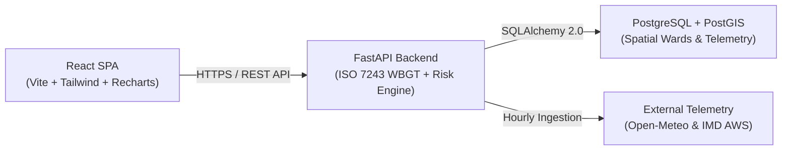

# ThermaGrid

<div align="center">
  
  <p><strong>Hyperlocal Human Thermal-Stress Early-Warning & Municipal Decision-Support System</strong></p>
  <p>Built by <a href="https://github.com/AkshatKardak">Akshat Kardak</a> · Released under the MIT Licence</p>
</div>

---

## Overview

ThermaGrid evaluates hyperlocal human thermal strain across Indian urban wards by coupling synoptic numerical weather models, authoritative ground telemetry, and microclimatic built-environment vulnerability metrics. 

The system computes physiological heat stress indices (ISO 7243 WBGT, UTCI, NOAA Heat Index) and models multi-hour indoor thermal phase delay across building archetypes to support municipal disaster response and public health action plans.

---

## Tech Stack

| Layer | Technologies |
|---|---|
| **Frontend** | React 19, TypeScript, Vite, Tailwind CSS, Recharts, Framer Motion |
| **Backend** | Python 3.12, FastAPI, Pydantic v2, SQLAlchemy 2.0, Alembic, Uvicorn |
| **Spatial & Analytics** | GeoPandas, NumPy, SciPy, react-simple-maps, d3-geo, Leaflet |
| **Database & Cache** | PostgreSQL, PostGIS, SQLite (development fallback) |
| **Auth & Ingestion** | Clerk, Open-Meteo API, IMD Telemetry Network |

---

## System Architecture



---

## Heat Vulnerability Formulation

The composite ward thermal stress score is formulated across four normalized dimensions:

$$R = w_h H + w_e E + w_v V - w_a A$$

- **Hazard ($H$):** Dynamic biometeorological stress derived via ISO 7243:2017 Wet-Bulb Globe Temperature (WBGT with Stull 2011 wet-bulb and empirical globe temperature), Universal Thermal Climate Index (UTCI), and NOAA Heat Index.
- **Exposure ($E$):** Population density, child/elderly age dependency ratios, and outdoor labor fractions.
- **Vulnerability ($V$):** Uninsulated corrugated tin/asbestos roof fraction, informal housing density, and baseline disease burden.
- **Adaptive Capacity ($A$):** Urban tree canopy fraction, municipal cooling centre proximity, and hospital bed availability.

---

## Quick Start

### 1. Repository Setup

```bash
git clone https://github.com/AkshatKardak/ThermaGrid.git
cd ThermaGrid
```

### 2. Backend Setup

```bash
cd backend
python3 -m venv .venv
source .venv/bin/activate
pip install -r requirements.txt

# Run migrations
alembic upgrade head

# Seed initial ward spatial geodata and telemetry
python seed.py

# Start development server
uvicorn app.main:app --host 0.0.0.0 --port 8000 --reload
```

The API will be available at `http://localhost:8000`. Interactive OpenAPI documentation is hosted at `http://localhost:8000/docs`.

### 3. Frontend Setup

```bash
cd ../frontend
npm install
npm run dev
```

The frontend application will be accessible at `http://localhost:5173`.

---

## Municipal Authority Console Access

The authority command console (`/app/authority`) provides ward-level risk rankings, intervention queue management, and emergency alert broadcast dispatching. Access requires verified administrative role permissions:

1. Sign in to the application using standard authentication.
2. In the Clerk Dashboard, navigate to **Users** &rarr; select the user &rarr; **Metadata** &rarr; **Public**.
3. Set the metadata key:
   ```json
   {
     "role": "authority"
   }
   ```
4. Sign out and sign back in to refresh the session claims. The municipal authority navigation tab and `/app/authority` console will unlock.

---

## Deployment

### Netlify (Frontend)

The repository root contains `netlify.toml` configured for automated SPA builds:

- **Build Base:** `frontend`
- **Build Command:** `npm ci && npm run build`
- **Publish Directory:** `dist`
- **Environment Variables Required:**
  - `VITE_API_BASE_URL` (points to the Render backend, e.g., `https://thermagrid-api.onrender.com/api/v1`)
  - `VITE_CLERK_PUBLISHABLE_KEY` (Clerk publishable key)

### Render (Backend)

The repository root includes `render.yaml` defining a web service:

- **Runtime:** Python 3.12
- **Build Command:** `pip install -r backend/requirements.txt`
- **Start Command:** `cd backend && alembic upgrade head && uvicorn app.main:app --host 0.0.0.0 --port $PORT --workers 1`
- **Health Check Path:** `/health`
- **Environment Variables Required:**
  - `DATABASE_URL` (PostgreSQL connection string)
  - `ALLOW_SQLITE_FALLBACK` (`false` in production)
  - `SCHEDULER_ENABLED` (`true` for scheduled ingestion)
  - `CORS_ORIGINS` (comma-separated allowed origins, e.g., `https://thermagrid.netlify.app`)

---

## Physics Reference Validation

ThermaGrid's biometeorological engines are verified against published reference standards and peer-reviewed worked examples in a table-driven test suite (`tests/analytics/test_physics_reference.py`):

| Biometeorological Metric | Reference Standard / Literature | Benchmark Scope | Max Observed Deviation | Tolerance Gate |
|---|---|---|---|---|
| **ISO 7243 WBGT** | ISO 7243:2017, Stull (2011), Bernard & Pourmoghani (1999) | 6 cases (psychrometric baselines, CAV coverall +2°C, CAV vapor barrier +11°C) | **0.3300°C** | $\pm 0.50^\circ\text{C}$ |
| **UTCI** | COST Action 730, Bröde et al. (2012), Błażejczyk et al. (2013) | 6 cases (reference baseline 20°C, moderate, strong, very strong, extreme >46°C) | **1.47°C** | $\pm 1.50^\circ\text{C}$ |
| **NOAA Heat Index** | Rothfusz (1990) NOAA NWS Technical Attachment SR 90-23 | 5 cases (worked example 90°F/70% RH, Caution, Danger, Extreme Danger) | **0.5100°C** | $\pm 0.60^\circ\text{C}$ |

> [!NOTE]
> Maximum observed WBGT deviation across all published ISO 7243 reference cases is **0.3300°C**, reflecting empirical Stull wet-bulb approximation against thermodynamic psychrometric tables.

### Synthetic Diurnal Sanity Backtest (Ahmedabad May 2010 Scenario)

The May 2010 Ahmedabad heatwave scenario is audited via an automated reproducibility pipeline (`scripts/backtest.py --check --max-mae 0.5`) evaluated against a synthetic diurnal benchmark fixture (`tests/fixtures/ahmedabad_2010_observed.json`).

> [!NOTE]
> **Synthetic Sanity Check Disclaimer:**
> The observation series (`tests/fixtures/ahmedabad_2010_observed.json`) is a synthetic diurnal sinusoid with bounded noise ($\pm 0.30^\circ\text{C}$), designed to verify internal consistency and ensure the model correctly reproduces diurnal cycles and thermal stress transitions. It is a synthetic sanity check, not a comparison against IMD weather station observations.

- **Air Temperature MAE:** **0.156°C** ($r = 0.9996$, RMSE 0.180°C)
- **ISO 7243 WBGT MAE:** **0.153°C** ($r = 0.9992$)
- **Peak Dry-Bulb Temperature:** 46.8°C modeled (synthetic fixture peaks at 47.0°C)
- **Peak Modeled WBGT:** 36.2°C (Exceeds ISO 7243 Extreme Alert Threshold)
- **Detailed Report:** See [Ahmedabad 2010 Backtest Report](docs/backtest/ahmedabad-2010.md) and [Metrics Artifact](docs/backtest/ahmedabad-2010.json).

---

## Data Assets & Remote Fetching

To preserve a lean repository footprint (<5MB tracked), heavy spatial shapefiles, raw geospatial dumps, and tabular CSV/Parquet artifacts are excluded from Git versioning via `.gitignore`. 

The repository tracks lightweight, topologically simplified boundary vectors for zero-dependency frontend rendering. Full-resolution datasets and external telemetry can be fetched or verified on demand using `scripts/fetch_data.py`:

```bash
# Verify integrity of current local datasets
python3 scripts/fetch_data.py --verify

# Fetch full-resolution GeoJSON boundaries and Census tables
python3 scripts/fetch_data.py --dataset all --force
```

### Dataset Registry & Sourced Links

| Dataset | Coverage / Content | Source & License | Local Target |
|---|---|---|---|
| **India State & UT Boundaries** | 35 States & Union Territories vector boundaries | [DataMeet Maps (Admin2 GeoJSON)](https://github.com/datameet/maps) · Open Data Commons ODbL | `frontend/src/assets/geo/india-states.json` |
| **Mumbai Ward Census 2011** | Demographics, slum density, and housing roof materials | [DataMeet Mumbai Wards](https://github.com/datameet/mumbai-ward-boundaries) · Public Domain | `data/raw/mumbai_wards_census_2011.json` |
| **Ahmedabad 2010 Scenario Fixture** | 72-hour synthetic diurnal progression (May 20-22, 2010 scenario) | Synthetic diurnal sinusoid with bounded noise (internal sanity check) | `tests/fixtures/ahmedabad_2010_observed.json` |

---

## Limitations

While ThermaGrid bridges the gap between regional synoptic forecasting and municipal decision support, users and civil authorities should interpret outputs within the boundaries of the following physical and physiological modeling constraints:

### 1. Indoor Ventilation & Air-Exchange Rates
The indoor thermal phase lag model simulates diurnal temperature attenuation and nocturnal heat retention across representative structural archetypes (e.g., informal uninsulated corrugated tin vs. engineered reinforced cement concrete) using lumped thermal capacitance and empirical phase-delay parameters. The engine assumes nominal natural infiltration rates and does not model real-time Computational Fluid Dynamics (CFD), occupant-driven window operation, ceiling-fan airspeeds, or dynamic air changes per hour (ACH). In dense informal settlements, restricted cross-ventilation can yield indoor temperatures exceeding outdoor ambient conditions by $2\text{--}4^\circ\text{C}$ beyond baseline model predictions.

### 2. Occupant Acclimatisation Dynamics
Physiological thresholds (such as work-rest cycles and WBGT risk categories) are referenced against ISO 7243:2017 standards differentiating between acclimatised and unacclimatised cohorts under steady-state assumptions. The system does not capture the transient kinetics of human seasonal acclimatisation—particularly during early-season heat spikes (e.g., March or April) when urban populations have not yet acquired cardiovascular and sudomotor adaptations—or the heightened vulnerability of transient, unacclimatised interstate migrant labor forces.

### 3. Individual Physiology & Clinical Heterogeneity
Standardized biometeorological indices (ISO 7243 / Stull WBGT, UTCI, NOAA Heat Index) simulate thermal strain for an idealized reference human (a healthy 75 kg adult male, $1.8\,\text{m}^2$ body surface area, standard metabolic activity). These indices cannot capture individualized physiological variance arising from:
- **Age extremes:** Infants with underdeveloped thermoregulatory mechanisms and elderly individuals with reduced sudomotor response and cardiovascular reserves.
- **Clinical comorbidities:** Cardiovascular diseases, chronic kidney disease, hypertension, and diabetes mellitus.
- **Pharmacological factors:** Consumption of diuretics, beta-blockers, anticholinergics, or antihypertensives that suppress peripheral vasodilation or sweating.
- **Maternal health:** Pregnancy-induced metabolic strain and elevated susceptibility to heat stress.

### 4. Ward-Level Spatial Resolution & Microclimatic Averaging
Telemetry and vulnerability indices are aggregated to the municipal administrative ward boundary scale ($2\text{--}15\,\text{km}^2$) to align directly with municipal governance, resource staging, and emergency alert jurisdictions. This spatial averaging inherently smooths out microclimatic extremes:
- **Urban Street Canyons:** Localized building height-to-width ($H/W$) ratios, vehicular heat corridors, and commercial HVAC condenser exhausts can generate intense localized thermal hotspots.
- **Micro-Scale Refuges:** Pockets of localized vegetative canopy, pocket parks, and shaded pedestrian alleys that offer thermal relief are averaged into the broader ward-level mean radiant temperature ($T_\text{mrt}$).

---

## Licence & Citations

- Distributed under the [MIT Licence](LICENSE).
- Meteorological calculations implement ISO 7243:2017 Wet-Bulb Globe Temperature (using Stull (2011) wet-bulb temperature with empirical globe temperature estimation) and Rothfusz (1990) National Weather Service Heat Index algorithms.
- Boundary geometries conform to official Survey of India administrative boundary standards.
