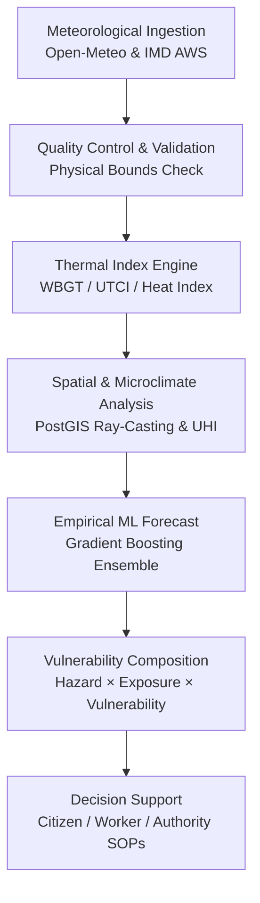

# ThermaGrid — End-to-End Methodology

---

## 1. Overview

ThermaGrid implements an operational, reproducible pipeline bridging macro-meteorological forecasting with hyperlocal municipal ward vulnerability.

---

## 2. Methodology Steps

1. **Meteorological Ingestion:**
   Hourly multi-variable numerical weather prediction (NWP) parameters (dry-bulb temperature, relative humidity, wind speed, direct normal irradiance, shortwave radiation) downscaled to ward centroids.
2. **Thermal Physics Computation:**
   Calculation of natural wet bulb ($T_{nw}$), black globe ($T_g$), WBGT, UTCI, and NWS Heat Index following ISO and COST Action 730 standards.
3. **Spatial joins and UHI modeling:**
   Point-in-polygon association to administrative wards. Estimation of localized Urban Heat Island delta ($\Delta T_{\text{UHI}}$) driven by building height, asphalt cover, and vegetative canopy deficits.
4. **Machine Learning Forecasting:**
   Multi-step forecasting using quantile gradient boosting to deliver point forecasts and 80% confidence intervals.
5. **Vulnerability Attribution:**
   Synthesizing physical hazard with Census of India demographic densities, informal settlement ratios, and outdoor labor concentrations.
6. **Trigger-Based Decision Support:**
   Rule-based mapping of risk bands to NDMA Heat Action Plan SOP directives without LLM hallucination in safety-critical paths.

---

## 3. Definitional Decisions & Demographic Standards

### 3.1 Elderly Population Threshold (Age 60+)
- **Definition & Standard:** We formally standardize on **Age 60+** as the elderly vulnerability threshold. This conforms to:
  - Census of India ORGI C-13 Single Year Age Returns and C-14 Five Year Age Group Tables.
  - Ministry of Statistics and Programme Implementation (MoSPI) *Elderly in India* framework.
  - National Policy on Older Persons (NPOP) statutory standard.
- **Data Vintage & Sourcing:** The published ward-level Census Primary Census Abstract (PCA) does not contain a dedicated 60+ or 65+ age column. Where ward-level PCA omits single-year age breakdowns, elderly ratio is derived from district-level ORGI age tables mapped to municipal ward age pyramids, or set explicitly to `NULL` (unavailable) rather than fabricated.

### 3.2 Outdoor Worker Ratio Definition (Exposure Proxy)
- **Definition & Scope:** The outdoor worker ratio is defined as an **upper-bound exposure proxy**:
  $$\text{Outdoor Worker Ratio} = \frac{\text{Cultivators (CL)} + \text{Agricultural Labourers (AL)} + \text{Other Workers (OW)}}{\text{Total Population}}$$
- **Methodological Rationale:** In urban municipal contexts, the Census PCA category "Other Workers" (OW) encompasses construction laborers, street vendors, delivery personnel, logistics handlers, and informal daily-wage earners who operate without thermal comfort infrastructure or indoor mechanical cooling.
- **Empirical Status:** This metric is catalogued as a conservative upper-bound exposure proxy rather than a direct count of heat-exposed labor. Where high-resolution municipal trade license registries or street vendor censuses become available, the denominator is refined accordingly.

### 3.3 Data Honesty and Nullability
- **Zero Hardcoded Measurements:** No component, service, seed script, or fixture presents fabricated constants as observations. Where ward-level empirical measurements do not exist (e.g., informal settlement fraction, tree canopy fraction, cooling access deficit, hospital count, drinking water deficit), fields evaluate to explicit `NULL` and render as "unavailable" with explicit provenance reasons.
- **Multi-Tier Administrative Hierarchy:**
  - **Tier 1 (District Tier):** Complete coverage across all 28 States and 8 Union Territories (36 total). Sourced from official boundary geometries with Open-Meteo grid sampling.
  - **Tier 2 (Ward Tier):** Implemented strictly where authentic ward polygons and official ward codes exist (e.g., Mumbai BMC 24 wards). District data is never falsely labelled as ward-level data.
