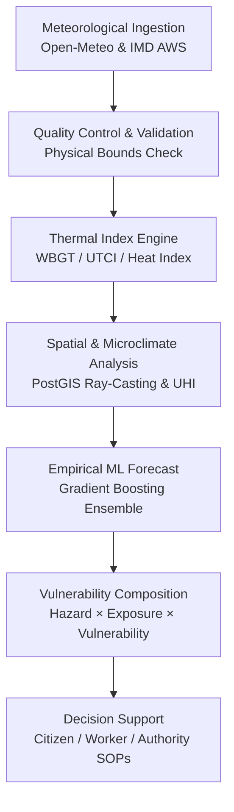

# ThermaGrid — End-to-End Methodology

---

## 1. Overview

ThermaGrid implements an operational, reproducible pipeline bridging macro-meteorological forecasting with hyperlocal municipal ward vulnerability.

---

## 2. Methodology Steps

1. **Meteorological Ingestion:**
   Hourly multi-variable numerical weather prediction (NWP) parameters (dry-bulb temperature, relative humidity, wind speed, direct normal irradiance, shortwave radiation) downscaled to ward centroids.
2. **Thermal Physics Computation:**
   Calculation of natural wet bulb ($T_{nw}$), black globe ($T_g$), WBGT, UTCI, and NWS Heat Index following ISO and COST Action 730 standards.
3. **Spatial joins and UHI modeling:**
   Point-in-polygon association to administrative wards. Estimation of localized Urban Heat Island delta ($\Delta T_{\text{UHI}}$) driven by building height, asphalt cover, and vegetative canopy deficits.
4. **Machine Learning Forecasting:**
   Multi-step forecasting using quantile gradient boosting to deliver point forecasts and 80% confidence intervals.
5. **Vulnerability Attribution:**
   Synthesizing physical hazard with Census of India demographic densities, informal settlement ratios, and outdoor labor concentrations.
6. **Trigger-Based Decision Support:**
   Rule-based mapping of risk bands to NDMA Heat Action Plan SOP directives without LLM hallucination in safety-critical paths.
